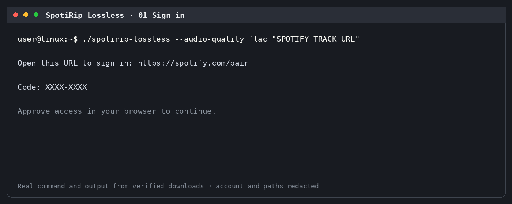

# SpotiRip Lossless

SpotiRip Lossless is a command-line downloader for Spotify tracks and music videos on Linux and Windows. It uses your own Spotify Premium account, selects the best available audio format, and writes the original audio stream without re-encoding.

Protocol and cipher resources are embedded in the executable. The application does not require a running Spotify client, a Spotify executable, Unicorn, Wine, or a graphical session.



## Features

- FLAC lossless downloads, plus the best available OGG Vorbis or AAC alternative when FLAC is unavailable
- Optional MP4 music video downloads with H.264 video and AAC audio
- Audio-only, audio-plus-video, and video-only modes
- Albums, artists, playlists, and text files containing Spotify links
- Bounded concurrent downloads, duplicate detection, retries, and HTTP Range resume
- Cover art and standard metadata without changing the encoded audio
- Optional lyrics, subtitles, and full container/decode verification
- A documented update process with HTTPS, SHA-256 verification, self-testing, and rollback

## Requirements

### Runtime

- Linux x86-64 or Windows x86-64
- A Spotify Premium account
- `ffmpeg` and `ffprobe` available on `PATH` for video processing, most metadata operations, duplicate detection, and `--verify`
- No additional native playback or C++ runtime libraries for release executables
- A user-supplied Widevine L3 `.wvd` device file for music videos

No MinGW installation is needed to run the Windows executable.

### Build

- Go 1.27 or newer
- C and C++17 compilers with CGo enabled and static C++ runtime support
- MinGW-w64 only for Windows cross-builds

Python is not required to use the downloader. It is only used for license collection and validation during a release build.

## Install

Download the latest package from [GitHub Releases](https://github.com/mcbabel/SpotiRip-Lossless/releases/latest), then extract it:

```bash
tar -xzf spotirip-lossless-linux-amd64.tar.gz
cd spotirip-lossless-linux-amd64
./spotirip-lossless --version
```

On Windows, download the Windows package and run these commands in CMD:

```bat
tar -xzf spotirip-lossless-windows-amd64.tar.gz
cd spotirip-lossless-windows-amd64
spotirip-lossless.exe --version
```

The release archive contains the executable, documentation, license, and notices. It does not contain credentials, WVD files, reference captures, or test downloads.

## Quick start

### Sign in with Spotify

SpotiRip Lossless requires your own Spotify Premium account for both audio and video downloads; anonymous downloads are not supported. Start a download with a Spotify link. On Windows, use `spotirip-lossless.exe` instead of `./spotirip-lossless` in all examples:

```bash
./spotirip-lossless "https://open.spotify.com/track/TRACK_ID"
```

On the first run, the program displays a verification URL and a one-time code:

```text
Open this URL to sign in: <verification URL>
Code: <one-time code>
```

1. Open the displayed URL in your browser.
2. Sign in to your Spotify account and enter the one-time code.
3. Approve access and return to the terminal. The download starts automatically.

Credentials are stored in `.spotify-credentials.json` in the current working directory and reused on subsequent runs. Keep this file private. To use a different location, pass `--credentials FILE`.

If you cancel before completing sign-in, the program reports a Spotify login error and does not download the track or video.

### Lossless audio

```bash
./spotirip-lossless --audio-quality flac \
  "https://open.spotify.com/track/2GxrNKugF82CnoRFbQfzPf"
```

If a track does not offer FLAC, omit `--audio-quality flac`; the default `best` mode selects the highest-quality available format:

```bash
./spotirip-lossless "https://open.spotify.com/track/TRACK_ID"
```

### Audio and music video

```bash
./spotirip-lossless --video --wvd "/path/to/device.wvd" \
  "https://open.spotify.com/track/TRACK_ID"
```

This produces the best audio-only file and an MP4 file.

### Video only

```bash
./spotirip-lossless --video-only --wvd "/path/to/device.wvd" \
  "https://open.spotify.com/track/TRACK_ID"
```

### Albums, artists, playlists, and link lists

```bash
./spotirip-lossless "https://open.spotify.com/album/ALBUM_ID"
./spotirip-lossless --limit 10 "https://open.spotify.com/artist/ARTIST_ID"
./spotirip-lossless --concurrent 3 "https://open.spotify.com/playlist/PLAYLIST_ID"
./spotirip-lossless links.txt
```

A link list contains one link per line. Empty lines and lines beginning with `#` are ignored. Duplicate tracks are removed after resolution.

## Common options

| Option | Description |
| --- | --- |
| `-o, --output DIR` | Output directory; default: `downloads` |
| `--credentials FILE` | Credential file path; default: `.spotify-credentials.json` |
| `--select` | Interactively select an audio format |
| `--audio-quality QUALITY` | `best`, `flac`, `ogg320`, `ogg160`, or `aac` |
| `--video` | Download audio and music video |
| `--video-only` | Download only the music video |
| `--video-quality PIXELS` | Maximum video height, such as `720` or `1080` |
| `--wvd FILE` | External Widevine L3 device file |
| `--concurrent 1-3` | Number of concurrent downloads; default: `2` |
| `--limit COUNT` | Limit the resolved download queue |
| `--on-duplicate MODE` | `skip`, `replace`, or `new` |
| `--output-template TEMPLATE` | Customize output paths |
| `--lyrics` | Download synchronized or plain lyrics from LRCLIB |
| `--subtitles` | Download and embed available video subtitles |
| `--verify` | Run FFprobe and fully decode each output with FFmpeg |
| `--self-test` | Verify login, metadata, PlayPlay, CDN access, and cipher processing |
| `--self-update` | Install a newer release from the configured update manifest |
| `--version` | Print the application version |

Output templates support `{artist}`, `{album}`, `{track}`, `{title}`, `{disc}`, and `{ext}`. The default is:

```text
downloads/{artist}/{album}/{track} - {title}.{ext}
```

A flat layout can be selected with:

```bash
./spotirip-lossless --output-template '{artist} - {title}.{ext}' "SPOTIFY_TRACK_URL"
```

## Audio and metadata behavior

- `best` prefers FLAC and otherwise ranks offers by their actual average bitrate.
- Audio streams are decrypted and packaged without re-encoding.
- FLAC, OGG/Vorbis, MP4, and other supported containers receive appropriate metadata and cover art.
- Tags include title, artists, album, track/disc numbers, date, ISRC, composer, copyright, and a single `SPOTIFY_URL` value where available.
- `.part` files can be resumed with HTTP Range and position-dependent cipher processing.
- `--verify` checks the finished file, including a complete decode.

## Updates

Configure the release manifest once:

```bash
./spotirip-lossless --self-update \
  --update-manifest "https://github.com/mcbabel/SpotiRip-Lossless/releases/latest/download/update-manifest.json"
```

The manifest URL is stored in `.spotirip-update.json`. Subsequent updates only require:

```bash
./spotirip-lossless --self-update
```

The updater verifies the archive size and SHA-256, runs the new executable's self-test, and only then replaces the current executable. A timestamped backup is retained. See [docs/SELF_UPDATE.md](docs/SELF_UPDATE.md).

## Build from source

```bash
go test -tags=nodsp ./cmd/... ./internal/...
go build -tags=nodsp -o bin/spotirip-lossless ./cmd/spotirip-lossless
```

To build the Windows executable from Linux with MinGW-w64:

```bash
GOOS=windows GOARCH=amd64 CGO_ENABLED=1 \
  CC=x86_64-w64-mingw32-gcc CXX=x86_64-w64-mingw32-g++ \
  go build -ldflags="-linkmode=external" \
  -o bin/spotirip-lossless.exe ./cmd/spotirip-lossless
```

Go dependencies are vendored. The semantic engine resources are embedded under `internal/spotifyclean/native`.

For local verification, build a release package with:

```bash
./scripts/build-release.sh
```

The resulting archive and SHA-256 file are written to `dist/`. This local package is for testing only.

## Project layout

- `cmd/spotirip-lossless`: CLI, login, downloads, batch processing, metadata, video, verification, and self-update
- `internal/spotifyclean`: Go engine API, CTR hot path, tests, and protocol metadata
- `internal/spotifyclean/native`: P-Code runtime, nested bytecode VM, and compressed semantic resources
- `reference`: Adjusted go-librespot and gowidevine sources
- `scripts`: Release build and license collection
- `docs`: User and update documentation

## Donations and future development

When Spotify changes break SpotiRip Lossless, restoring compatibility requires substantial analysis, development, and testing. These maintenance updates are only financially viable through donations. If you rely on the project, I would greatly appreciate your support.

A free website for downloading Spotify songs with your own Spotify account is also planned. Donations will help fund its development, hosting, and ongoing maintenance.

[Support SpotiRip Lossless through GitHub Sponsors](https://github.com/sponsors/mcbabel)

## Development

See [CONTRIBUTING.md](CONTRIBUTING.md) for build and review guidelines.

Additional documentation:

- [Video downloads](docs/VIDEO.md)
- [Metadata and cover art](docs/METADATA.md)
- [Self-update](docs/SELF_UPDATE.md)

## License and notices

First-party code, documentation, and generated semantic resources are licensed under [CC BY-NC-SA 4.0](LICENSE). NonCommercial use, including a noncommercial public service, is permitted with attribution. Shared adaptations must use the same license and indicate changes.

This is a source-available license, not an OSI-approved open-source license. Third-party components remain under their respective licenses; see [THIRD_PARTY.md](THIRD_PARTY.md), [NOTICE](NOTICE), and the `licenses` directory.

The project license covers the software, not Spotify content. Users are responsible for complying with applicable content rights and Spotify terms.

SpotiRip Lossless is not affiliated with or endorsed by Spotify.
